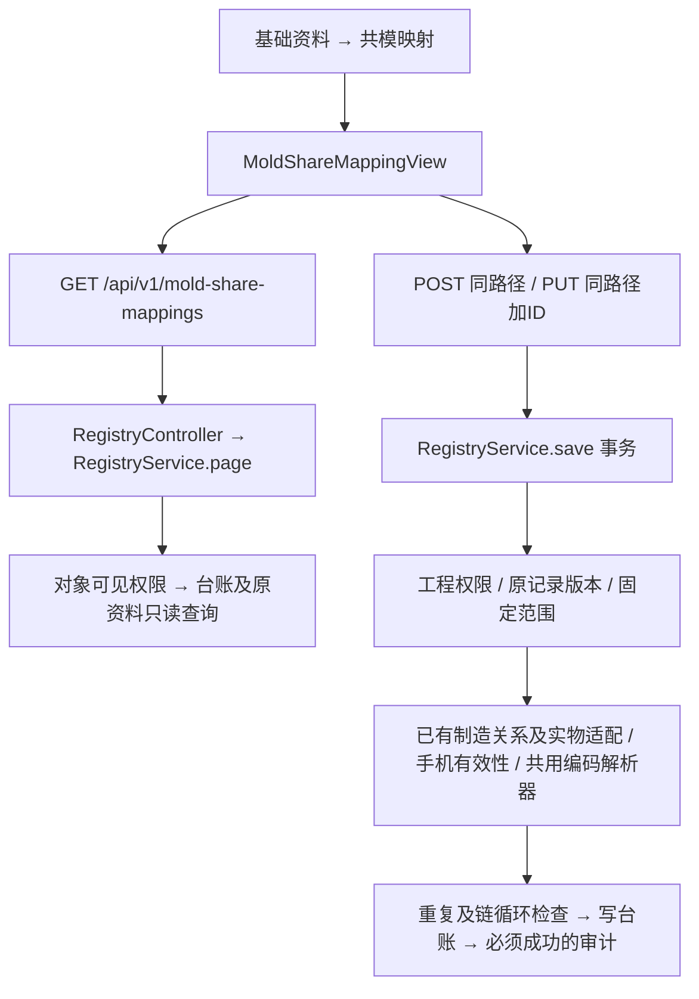

# 基础资料共模映射实现与验收报告

日期：2026-11-10。依据《基础资料共模映射入口与台账小增量方案-20261110》。

## 1. 当前交付状态

### 14:57 本地启动配置修复

用户反馈新版页面请求404。实查本地server容器已回到旧镜像`local-product-code-entry-20261109`，旧包没有台账接口。此前仅使用临时Compose覆盖文件，默认`compose.yaml`仍指旧版，普通启动可使后端回退。本次将默认server、web镜像更新为已验收的台账增量版本，沿现有CRM环境覆盖配置启动server/web。CRM网关不重建，正式环境不变。修复后列表接口HTTP200、业务code=0、总数0且工程账号canWrite=true；入口和原颜色编码页浏览器验证通过。

代码已实现，并先在独立本地验收系统完成验证；2026-11-10 13:48进一步增量更新到原本地系统8111。入口：**基础资料 → 共模映射**。

- 原本地系统当前地址：http://127.0.0.1:8111/#/mold-share-mappings
- 8111实际浏览器核验：入口、最新台账页面与原颜色编码页面均可见，无页面运行错误。

- 网页：http://127.0.0.1:5174/#/mold-share-mappings
- 独立后端：127.0.0.1:8113。
- 独立数据库：`plm_mold_registry_acceptance_20261110`，由原本地数据库复制。
- 原本地8111网页和对应本地后端已切换为白名单增量镜像；CRM网关没有重建，正式环境没有切换。**这不是正式发布完成报告。**
- 现有账号数据随副本保留；账号须具备 `collaboration:view` 和国内资料查看资格。维护权限由现有工程权限服务判定。

## 2. 已实现效果

1. 独立台账可查询产品、自身机型、基准机型、材质、孔型、结构说明和状态；支持关键字、分页及重置。
2. 显示原模具编码、主档ID、实物套ID、工程关系ID及版本、确认依据、映射状态／版本和更新时间；已确定失效的关系显示重新核对提示。
3. 有维护权限的工程人员可新增、维护、停用；普通查看入口没有保存按钮。服务端仍独立鉴权，不信任前端权限值。
4. 保存前核验已有实物适配关系、版本、手机有效性、原码材质及基准手机段、孔型和映射范围；不按机型文字猜配。
5. 编辑时锁定产品、自身机型、材质、孔型及结构范围，换范围须停用后新增；拒绝重复有效范围、链式映射和循环。
6. 停用允许原工程依据已经过期，但不能借停用改变范围；停用只更新状态、版本和操作人，修改原因进入审计，其他表单内容不改写原证据。
7. 快速筛选只接受最后一次请求的返回结果；读取错误明确显示；保存失败保留输入；保存中拦截重复提交；关闭未保存表单需确认。
8. 保存映射不创建采用确认、审批、SKU、库存或新模具，也不调用钉钉和CRM外发。

空台账明确提示“尚未维护共模映射；不会从兼容型号文字自动生成。”；单材质映射不表示PC／TPU整套共模。

## 3. 代码与文件

| 文件（相对仓库根目录） | 实际处理 |
| --- | --- |
| `plm-web/src/views/mold-sharing/MoldShareMappingView.vue` | 重构为独立台账，加入筛选、只读查看、维护弹窗、错误与请求竞争处理 |
| `plm-web/src/api/modules/moldSharing.ts` | 扩展可选材质筛选、更新时间及依据状态字段；保留原接口函数 |
| `plm-web/src/locales/es-ui.json` | 补充台账及提示的西语文本 |
| `plm-web/src/views/mold-sharing/__tests__/MoldShareMappingView.spec.ts` | 请求竞争、接口失败、保存失败和重复点击测试 |
| `plm-server/src/main/java/com/yuewei/plm/module/moldsharing/MoldShareMappingRegistryController.java` | 新增独立台账控制器，接管原路径的列表、新增和修改 |
| `plm-server/src/main/java/com/yuewei/plm/module/moldsharing/MoldShareMappingRegistryService.java` | 新增只负责台账查询／维护的事务服务，复用现有解析、工程、手机、权限及审计服务 |
| `plm-server/src/main/java/com/yuewei/plm/module/moldsharing/MoldShareMappingController.java` | 移出台账三项映射，避免完整源码启动时重复路由；原resolve／confirmations仍留原控制器 |
| `plm-server/src/test/java/com/yuewei/plm/module/moldsharing/MoldShareMappingRegistryTest.java` | 新增5项权限、版本、停用和审计异常测试 |
| `scripts/build_mold_registry_overlay.py` | 从运行基线编译新增台账类，逐项验证旧JAR内容未改 |
| `scripts/verify_mold_registry_preview.py` | 仅对指定独立验收库准备验收账号、验证登录与列表 |
| `scripts/verify_mold_registry_fixture.py` | 仅在指定独立库创建明确标记的模拟依据，验证真实保存流程 |
| `plm-web/verify-registry-preview.cjs` | 实际浏览器打开页面，生成列表／弹窗／尺寸与西语截图 |
| `../20261017-c856_bHNzr/local-runtime/compose.mold-registry-preview.yaml` | 独立后端及Redis运行配置，关闭历史启动导入，不共享原上传目录 |

原侧栏和路由源码已包含该入口，本次复用；浏览器已确认入口位置。未新建数据库迁移：验收基线中台账及相应迁移20261109.2100已经存在，未重写历史迁移。

## 4. 调用链路与接口兼容

现有GET／POST根路径和PUT `/{id}`不变，请求主体不增加必填项；列表增加可选字段。原resolve和confirmations接口未改变语义；台账页面不调用它们。工程关系选择器只读取已有事实，不在保存映射时补建关系。

台账写入与审计处于同一Spring事务。单元测试覆盖审计异常传播及事务注解；**尚未执行数据库层审计失败的真实回滚注入验收**，不可把单元测试等同于完整回滚验收。

## 5. 运行验证证据

| 验证 | 结果 |
| --- | --- |
| 前端类型检查 | `vue-tsc --noEmit`通过 |
| 页面3项＋侧栏20项测试 | 23项通过；测试桩有组件／路由告警，不影响通过结果 |
| 前端生产构建 | 已通过；生成`plm-web/dist-registry-preview`，没有覆盖原系统前端 |
| 后端完整源码编译、测试编译 | 通过 |
| 台账5项＋编码解析17项测试 | 22项通过 |
| 独立运行包旧内容校验 | 原1456项字节不变，仅增加RegistryController、RegistryService和WriteInput共3个class |
| 实际登录／列表接口 | 通过，工程维护资格返回true |
| 实际浏览器 | 入口和新增弹窗可见；1788／1000／900像素截图已生成，无pageerror |
| 独立数据库实际新增、更新、停用 | 全部通过，保存后重新读取有效 |
| 重复新增、过期版本更新 | 服务端拒绝，未产生重复记录 |
| 映射保存前后产品／库存／开模申请数量 | 未变化（这是数量校验，不代表全表字段校验） |

实际保存模拟记录：主档1064、实物套601、映射1；名称和证据均标记QA／隔离模拟／非真实工程事实，映射验收结束已停用。没有向原本地库或正式库写入此模拟数据。验收准备阶段单独创建模拟工程依据，不是映射保存自动创建工程关系。

证据目录：`plm-server/registry-release-r2/`。

- `whitelist-verification.json`：原JAR逐项比较及新增白名单。
- `save-verification.json`：实际保存、更新、冲突、停用及数量校验证据。
- `browser-verification.json`：浏览器结果。
- `registry-list.png`、`registry-create.png`、`registry-create-1000.png`、`registry-create-900.png`：实际界面。
- `registry-saved-inactive.png`、`registry-spanish.png`：已保存的停用模拟记录及西语效果。
- `browser-session.private.json`是验收登录会话，属于敏感临时产物，禁止纳入发布包或公开传播。

## 6. 受影响模块与边界

直接影响：基础资料共模台账页面、列表／维护接口、权限判断和操作审计。只读依赖：产品、手机、模具原码、主档、实物套、制造关系与实物兼容证据。

本次未修改编码生成器、旧制造／采用／审批消费逻辑、SKU／BOM／库存／成本／订单，未切换CRM网关或原系统镜像。独立后端使用本地运行基线加3个新类，不将工作区其他编码、孔型、审批改动整包发布。

## 7. 当前限制与正式发布剩余条件

1. **正式两台服务器尚未发布此功能**；本次可见地址是本机独立验收地址，其他电脑不能通过127.0.0.1访问。
2. 验收运行基线较旧，只保证已有九位码流程的实测；十位码及混合孔型依赖原系统解析器和工程关系的独立升级，缺少能力时明确拒绝，不在台账补丁中替换生成器。
3. `relationCurrent`提示依据明确的关系状态／版本及原码状态变化，不等于完整实物兼容摘要的持续有效认证；真正保存时重新调用完整工程解析验证。
4. 普通只读账号、对象越权、审计故障回滚和全部原业务接口尚未完成数据库级端到端回归；权限、范围和事务路径已有代码／单元测试保护。
5. 正式发布前须只读确认正式运行包、前端版本、台账结构及迁移状态，再基于正式基线合并白名单。当前本地基线包不能直接视为正式基线。后续发布应沿原协调流程，不能覆盖其他任务运行包。

本地镜像：`yuewei-plm-server:local-mold-registry-only-20261110`。独立Compose项目：`plm-mold-registry-preview-20261110`。后台Vite网页服务监听5174，日志在上述证据目录；后端监听8113且只绑定本机。

如机器重启，先在`20261017-c856_bHNzr/local-runtime`运行`docker compose -f compose.mold-registry-preview.yaml up -d`，再在`DeepLinkPLM-main/plm-web`设置`VITE_PORT=5174`、`VITE_API_TARGET=http://127.0.0.1:8113`后运行Vite；勿重启原5173／8111或CRM服务。
