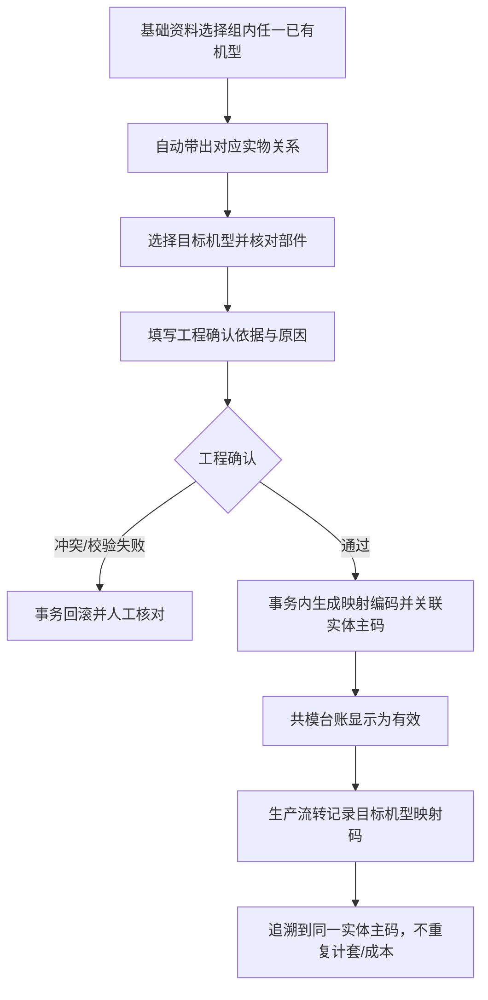

# 基础资料共模工程确认与映射模具编码方案

日期：2026-11-11（根据业务确认更新）  
性质：方案沉淀及本地实现记录；**未在正式数据库执行迁移，也未发布系统**。  
关联现状：[基础资料共模映射入口与台账小增量方案-20261110.md](基础资料共模映射入口与台账小增量方案-20261110.md)、[基础资料共模映射实现与验收报告-20261110.md](基础资料共模映射实现与验收报告-20261110.md)。

## 1. 目标与已确认业务口径

在基础资料共模映射页维护“目标机型 → 已有实体模具”的关系。工程人员选择基准机型、已确认的实体模具关系和目标机型并直接确认后，建立目标手机型号到既有实体模具的映射；不发起开模申请、不提交钉钉审批。原开模申请与原“沿用”语义保持不变。

多个手机型号各自可以有映射模具编码，但这些编码指向同一个实体模具。实体的总模具编码（主编码）以最早出现且有可信证据的原始模具编码为准，后续映射不替换、不重编原编码，也不另造实体模具。

业务目的：能够复用已有的一副实体模具时，不为新机型重复开模，以减少开模及重复计套成本。映射编码不是第二副模具，也不代表新增实物套；多个机型编码在主数据关系上指向同一实体模具。

示例：实体主编码 `MBA10J1121` 属于最早开模的手机A；手机B的映射模具编码 `MBA10J0122`、手机C的映射模具编码 `MBA10J1348` 均指向同一实体模具，其主编码仍为 `MBA10J1121`。按本次确认的口径，映射码沿用现有 v2 模具编码字段格式，末尾手机码使用映射机型自身的四位码；实体归属通过独立的实体模具/映射关系表达，而不是从编码字符串推断。编码示例用于说明格式和关系，不代表当前映射服务已实现自动分配。

生产流转口径：实际生产流转按当前机型对应的映射模具编码记录和流转，使生产、品质及追溯人员能识别本次使用的模具编码；映射编码再关联到实体主编码，用于识别这些编码对应同一副实体模具。不能为了归并实体而把生产记录都改写成基准机型主编码，也不能因为生产单据使用映射码就新建另一副模具套。

边界：映射关系本身不新增物理模具套、库存、采购/成本记录，不改变各手机型号自己的手机码/SKU；实体模具/实物套及成本核算按实体主身份去重，生产履历保留实际机型映射码。PC、TPU等不同材质部件分别建映射，不能由单一材质推导整套共模。

## 2. 当前系统基线与差距

- 基础资料共模台账入口及独立查询/维护服务已在本地实现，正式服务器尚未发布。实现报告记录该台账指向现有原模具编码及制造关系。
- 现有 `plm_mold_share_mapping` 记录的是来源手机、基准手机、材质/孔型/结构、现有 `product_mold_code_id`、制造关系及证据；当前并没有“映射编码身份 + 实体模具主身份”的专用模型。因此本方案提出的映射编码/实体主编码结构属于后续增量，不应当误认为现有台账已具备。
- 开模申请表单已有新建/沿用处理语义；前端“沿用”是确认采用既有实物套，不发起新申请。本次共模映射由基础资料独立确认，不改变开模申请接口和既有申请流程。
- 已确认的基准制造关系、实体模具、部件编码和实物套是映射来源；目标机型映射完成后补充其制造关系，以便生产身份按目标机型解析映射码。

## 3. 业务流程

1. 工程人员从“基础资料 → 共模映射”点击“工程确认新机型共模”。
2. 选择产品后，从其已确认的机型/实物关系中选择共模组基准；若同一副模具已有多个共模机型，任选其中一个即可。选择目标机型。不得仅凭型号相似或自由文本自动匹配。
3. 核对基准关系完整的 PC/TPU 部件、实体主码、孔型、结构及目标机型编码，填写工程确认依据和原因。
4. 点击确认后，服务端重新校验关系版本、数据权限、主码和编码唯一性，在一个事务中创建/启用映射编码身份、关联实体主码并建立目标机型制造关系，同时记录审计；任一环节失败则整笔回滚。
5. 工程确认成功后映射立即生效并进入台账；生产流转使用目标机型自己的映射模具编码记录实际用模，并通过映射关系追溯实体主码。同一实体的模具套数、库存及成本不可按映射编码重复累计。

## 4. 数据及编码建议

概念上区分三层，实施时先检查现有模具主档能否承载“实体ID”，避免重复造主数据：

| 概念 | 含义 | 建议约束 |
| --- | --- | --- |
| 实体模具 | 物理模具身份；允许多个机型/编码指向它 | 一个实体有且仅有一个锁定主编码；多个映射直接指向实体，不允许链式映射 |
| 主模具编码 | 最早出现并由可信证据支持的原始编码 | 历史原值不可重写；确认依据、确认人、确认时间可追溯；普通维护不可改主编码 |
| 映射模具编码 | 共模手机型号对应的编码别名 | 对目标实体唯一；记录适用机型、材质/部件、孔型、结构及工程确认依据；不创建新的实体或实物套 |

拟增加的关系数据至少需要：映射记录ID、实体模具ID、主编码引用、映射编码、产品线、适用手机型号、基准手机型号、材质/部件、孔型、结构说明、目标制造关系/实物套引用、来源基准制造关系、工程确认人/时间/依据、状态、版本和审计字段。本流程不需要申请或钉钉审批记录。

主编码按可信时间证据确定（开模事实、采购/验收或已核验历史台账）；不能只按数据库插入时间或编码字典序决定“最早”。若无法判定，工程确认并留证后锁定；冲突记录禁止自动生效。映射编码不另造一套编码段或序号，而是沿用现有 v2 格式按目标机型自身手机码形成机型编码；服务端需要在实体模具关系中登记映射编码并做唯一性校验。工程确认前不占用正式映射编码，确认后在事务中生成正式关系。

### 4.1 编码规则（方案口径）

1. **一个实体一条主编码**：实体模具的主编码是其原始模具编码，代表实体身份；以可核验的最早开模事实为准。主编码确认后锁定，不因增加共用机型、映射编码或后续申请而重新编号。
2. **每个共用机型/部件单独一个映射编码**：新增映射编码作为该机型对同一实体模具的别名，必须关联实体模具ID和主编码ID；编码不是新的模具实体号，不得据此创建新模具主档或实物套。不同材质部件（如PC、TPU）分别建立映射，不能共用一个部件映射编码来表示整套模具。
3. **映射关系直接指向实体**：手机B、手机C的映射编码都直接指向手机A最早开模形成的同一实体及其主编码；禁止B映射到A映射、再间接指向实体的链式关系，也禁止循环引用。
4. **编码格式与示例**：映射编码沿用现有 v2 模具编码格式：`M + 产品特定码2位 + 材质码2位 + 孔型标记D/J/H + 目标手机码4位`。例如主编码 `MBA10J1121` 是实体模具的稳定主编码；机型B的映射编码 `MBA10J0122`、机型C的映射编码 `MBA10J1348` 分别使用各自机型码，均关联同一实体。查询或展示须明确区分“映射编码”和“实体主编码 MBA10J1121”。映射不改变产品、材质、孔型等编码段含义，也不把目标机型 SKU 改成基准机型码。
5. **不得重用或改写历史编码**：已有模具原编码保持原样；若历史机型需要补充共模关系，应新建映射记录/映射编码，不覆盖历史申请中的编码、不重编主编码。若发现重复或冲突，进入人工核对，不自动挑选覆盖。
6. **生成时点**：基础资料工程确认前不分配正式映射编码。工程确认通过时，服务端在事务中按唯一规则生成/分配映射编码并绑定实体主编码，同时写目标机型制造关系、台账和审计。工程确认未通过时不产生有效映射编码；如未来采用预留号段，必须另行定义释放、重试和审计机制。
7. **生成责任与冲突处理**：格式已确认复用现有 v2 规则，不另设前缀、序号段或序号作用域；后端应复用 `ProductBusinessCodeGenerator` 生成/校验编码，前端不得自行拼码。映射编码必须全局唯一：若同一编码已被记录为另一个实体的编码、正式模具编码或有效预留码，禁止覆盖、自动归并或改写，记录进入 `needs_review` 人工核验；只有工程证据确认是同一实体时，才能通过受控纠正流程处理历史归属。编码唯一性与实体归属是两个不同约束——编码按目标机型生成，是否共模由显式实体映射决定。
8. **显示和生产流转**：台账、生产流转和后续查询显示并传递当前机型对应的映射编码，同时保留实体主编码关联、适用机型、材质/部件及映射状态。只有工程确认生效的映射可用于新生产流转；生产履历保留实际使用的机型映射码，追溯/实体归并通过映射关系回到主编码。涉及旧排程/生产接口时优先新增字段或分支，保持旧请求兼容；映射码不得被消费端误建成新实体、额外实物套或独立成本对象。

## 5. 代码和文件影响范围（拟议）

以下为基于当前源码的建议清单，实际实施前需再确认正式部署分支、迁移编号和文件是否已被其他增量占用。

| 文件/模块 | 建议增量 | 兼容原则 |
| --- | --- | --- |
| `plm-web/src/views/mold-applications/components/MoldApplicationEditor.vue` | 增加处理方式选择、共模目标选择及表单校验/摘要；新开模现有表单不改 | 不改变现有“沿用”按钮的确认采用语义；共模是新增明确选项 |
| `plm-web/src/api/modules/moldApplications.ts` | 增加共模候选查询/工程确认等新增接口的类型与调用 | 原保存、提交、沿用和历史关联调用保持兼容 |
| `plm-server/src/main/java/com/yuewei/plm/module/moldapplication/` | 不增加新的申请送审分支；保留既有申请/沿用接口 | 旧申请和接口行为不变 |
| `plm-server/src/main/java/com/yuewei/plm/module/moldsharing/` | 基础资料入口直接工程确认实体身份映射；向生产流转提供机型映射码到实体主码的解析 | 通过独立接口写映射，不让前端散写台账SQL；旧消费请求保持兼容 |
| `plm-server/src/main/resources/db/migration/` | 新增向前兼容迁移：实体身份/映射编码关系、唯一约束及必要索引 | 不改写既有编码数据；先检测是否有已存在同名表/索引，迁移必须可重复验证 |
| `plm-web/src/views/mold-sharing/` 及基础资料路由/菜单配置 | 提供直接工程确认入口，展示映射编码、实体主编码、基准机型和实物套 | 保留既有台账查询维护能力；未确认映射不进入可用结果 |
| `plm-server/src/test/.../moldsharing/`；前端相邻 `__tests__` | 覆盖确认校验、编码唯一性、生产解析及失败回滚 | 旧接口行为保持兼容，新增测试针对直接确认契约 |

不建议第一阶段改动 `ProductBusinessCodeGenerator` 的既有模具码生成逻辑，除非映射码格式评审确认必须复用并补齐解析/展示全链路。先通过独立映射编码服务和字段表达概念；确认与旧格式兼容后再单独提议编码器增量。

## 6. 接口兼容与状态策略

- 共模关系从基础资料直接确认，不改造开模申请保存/提交请求，也不增加新的钉钉审批分支。
- 旧的“新开模”、既有“沿用实物套”、研究流程、编码预留、历史关联和审批同步的既有含义不变。
- 新增只读候选接口及显式工程确认接口；不要用现有 `/historical-association` 或 `/codes` 偷渡映射创建。
- 映射确认前不建立可供生产使用的有效记录；工程确认后为 `active`。停用保留历史，编码或实体冲突进入人工核对，不允许自动覆盖。
- 台账编辑只允许修正可编辑属性；目标实体、主编码和历史证据需走有权限、版本校验和原因记录的专门纠正流程。停用不删除历史，不级联改变实体/原编码/库存。

## 7. 受影响模块与明确不影响范围

直接受影响：模具实体/映射台账、基础资料入口、目标机型制造关系、工程权限和操作审计。

只读或校验依赖：手机型号及编码、产品线、现有模具主档/部件、制造关系和实物兼容关系。

本方案不改变：既有开模申请和钉钉审批、现有模具编码生成规则、历史原编码、手机型号自身编码、SKU/BOM、采购/成本算法、库存数量、CRM接口及已有采用确认流程。生产流转明确需要记录映射模具编码；本方案要求新增分支兼容接入，不以映射码创建新模具实体或重复累计库存/成本。只有基础资料工程确认完成后映射才生效并可用于后续生产流转。

## 8. 小增量实施顺序与验收

1. 先核对正式环境迁移状态、现有主档和台账数据，确认实体ID的权威来源以及主编码证据规则；形成字段/API契约。
2. 仅新增迁移和后端映射身份服务，先实现历史补录的待确认/生效规则与只读查询；确保不影响旧台账和消费接口。
3. 在基础资料增加共模工程确认入口，读取已确认基准制造关系并选择目标机型；确认前不生成可用映射。
4. 确认后在事务中创建映射编码、实体关联、目标机型制造关系、台账行及审计记录。
5. 灰度用隔离数据验证，完成回滚演练后再评估两台正式服务器发布；不得把本地验收库或截图当作正式服务器已发布证明。

最低验收覆盖：共模不创建开模申请或钉钉审批待办；工程未确认前不产生有效映射；确认后多个机型编码指向同一实体且主编码稳定；生产单按本机型映射码记录并可追溯实体主码；同一实体/适用范围重复提交和并发写入被唯一约束拦截；PC/TPU完整核验；写台账或审计失败整笔回滚；停用保留历史；无新实物套、库存、SKU或成本副作用。

## 9. 待实施前确认事项

- 当前正式两台服务器的代码、迁移版本和共模数据是否一致；不能假定本地8111状态等于正式状态。
- 映射编码格式沿用 v2 规则已确认；实施时仍需核实目标环境解析、搜索、展示、打印链路是否均接受 v2 十位格式，并明确编码冲突进入待核查队列后的责任人与处理时限。
- 一个实体模具下的部件/实物套粒度，以及当历史记录缺少明确实体ID时如何人工归并。
- 工程确认的角色权限、必要附件/证据及主编码冲突的处理人。
- 已经在产品上采用后停用映射时的处理政策；不应由本次映射维护静默改写已发生的生产履历/采用快照。生产记录应保留当时使用的映射码及可追溯的实体主码。

## 10. 实现状态与验收记录（2026-11-11）

本次按最终业务口径调整为基础资料直接维护：不发起开模申请、不走钉钉审批；工程人员选择已确认的基准机型和实物套、目标机型并直接确认，确认成功后映射立即生效。旧申请相关后端分支保留兼容，但前端不再提供“共用已有（送审批）”选项或申请详情工程确认入口。实现不重编码实体主码，也不创建新实物套、库存、SKU 或成本记录。映射码沿用 v2：`M + 产品特定码2位 + 材质码2位 + 孔型D/J/H + 目标机型码4位`；目标机型使用自身四位码。PC/TPU 分别建立映射，多个机型映射直接指向同一实体和最初主码。

主要实现文件：

- `plm-server/src/main/resources/db/migration/V20261111_1100__mold_entity_mapping_codes.sql`：新增模具实体身份和机型映射编码表及唯一约束。
- `plm-server/src/main/java/com/yuewei/plm/module/moldapplication/MoldEngineeringPlan.java`、`MoldApplicationService.java`：保留旧申请/沿用语义；新申请界面不再提供送审批共模分支。
- `plm-server/src/main/java/com/yuewei/plm/module/moldsharing/MoldShareMappingService.java`、`MoldShareMappingController.java`：新增基础资料直接工程确认接口；从已确认基准制造关系解析完整实物部件，生成并唯一校验映射码，保存实体/映射关系、目标机型制造关系与审计，并提供映射码列表和追溯查询。旧审批确认接口保留兼容。
- `plm-server/src/main/java/com/yuewei/plm/module/manufacturing/ManufacturingIdentityService.java`：在制造关系详情中显示当前机型映射码和实体主码；只有当前机型的实体部件映射完整且有效时，生产解析才使用映射分支，否则继续原兼容性校验。
- `plm-web/src/api/modules/moldSharing.ts`、`plm-web/src/views/mold-sharing/MoldShareMappingView.vue`：基础资料增加“工程确认新机型共模”入口及已生效映射码台账，展示目标映射码、实体主码、基准机型和实物套。
- `plm-web/src/views/mold-applications/components/EngineeringPlanEditor.vue`、`MoldApplicationDetailDrawer.vue`：新申请隐藏送审式共模选项和对应申请后确认按钮，旧申请数据读取仍兼容。
- `plm-server/src/test/java/com/yuewei/plm/module/moldapplication/MoldEngineeringPlanTest.java`、`ManufacturingIdentityLocalIntegrationTest.java`：覆盖共模分支归一化/校验，并同步服务构造依赖。

调用链路：

1. 在“基础资料 → 共模映射”点击“工程确认新机型共模”，选择产品后，从已有制造关系中选共模组内任意一个机型，系统自动带出该机型对应的实物套关系；再选择目标机型并填写工程确认依据和原因。
2. 后端重新校验基准关系版本、产品/实物套、实体部件、原始主码、目标机型和编码占用；在同一事务生成目标机型映射码、写入实体身份及映射关系，并建立目标机型指向同一实物套的制造关系。冲突或任一步失败则整笔回滚；不产生开模申请或审批待办。
3. 新增映射码立即出现在基础资料的“已生效实体映射码”表中，可见目标机型映射码、实体主码、基准机型、材质、实物套及工程依据。
4. 制造身份查询按目标机型取其映射码，并返回实体主码供追溯；生产解析仅消费完整、有效的显式映射，未映射关系仍沿用原兼容性检查。

测试记录：后端定向 Maven 构建成功，`MoldEngineeringPlanTest` 9 项、`MoldShareMappingRegistryTest` 5 项通过；`ManufacturingIdentityLocalIntegrationTest` 的 17 项在当前环境被条件跳过。前端 `npm run type-check` 与生产构建通过；最终流程对应的开模申请编辑器/详情及共模台账/选择器定向 Vitest 共 4 个文件、79 项通过。前端全量 Vitest此前发现两个与本次共模功能无关的问题：`SelectionFileTasks.spec.ts` 的文案断言不一致，以及 `sampleLabelExport.spec.ts` 的 500 条标签用例超过 5 秒；全量运行未正常退出，已终止。当前未连接可迁移的业务数据库，未完成真实 SQL 迁移及工程确认到生产解析的端到端数据验证。

此为代码实现和本地测试记录，不代表已发布到两台正式服务器。正式发布前仍需按第9节核对两台服务器基线、执行迁移演练、核实基准实物主码/部件和映射冲突，并完成隔离数据业务流和回滚验收。
